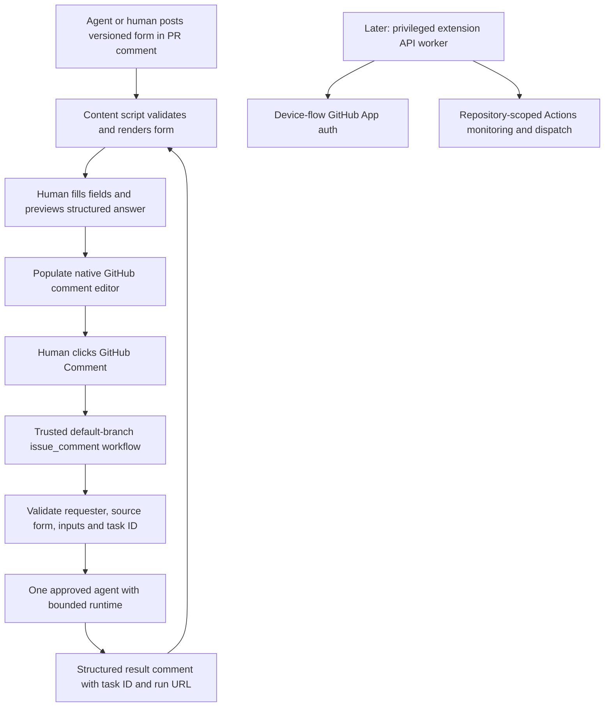

# GitHub Ultimate — intake analysis

Reviewed 2026-11-05. Source: [initial intake](https://github.com/mickmister/github-ultimate/issues/1), which had no comments at review time. The project checkout initially contained only README.md and an MIT license. This document records static source analysis, not a successful extension build or live browser/agent demonstration.

## Goal

Enhance GitHub itself into a personal-account human/agent workspace, with GitHub-hosted persistence and Actions execution, Chrome first and Safari iOS architecturally supported. No paid Copilot or dedicated application backend is required. First milestone: complete a PR form, submit answers through GitHub, execute one agent in Actions, and receive a correlated structured PR response.

## Evidence and adoption decisions

| Source | Local checkout / revision | Findings |
| --- | --- | --- |
| Commit Lens | `/home/vkuser/repos/commit-lens`, `69fd101ff2825d49c3a37958b7fb2bd4ec0320f2` (2026-09-13) | Not archived; JavaScript MV3 extension, direct-load installation; no license file or package license; GitHub reports license null. |
| GitHub Monaco | `/home/vkuser/repos/browser-ext-github-monaco`, `cb32dd4167d2a65d225b894a2aed63ffe86bbb36` (2024-12-28) | Archived; TypeScript, webpack 5, Monaco 0.52.2, MV3; package explicitly `UNLICENSED`, no license file; GitHub reports license null. |
| Vibe dashboard | `/home/vkuser/repos/vibe-kanban-vscode-web`, HEAD `a76a0c8571662dea9e9f477b41112184dba5c6cd` | Portable form package plus separate Springboard/server/bead integration. Root license Apache-2.0 unless a subtree overrides it. |

Use a new TypeScript extension. Neither extension currently provides a reuse grant: use independent implementations unless permission is obtained. Monaco Editor itself is a distinct dependency whose license/notices can be checked separately. Dashboard reuse requires retaining applicable Apache notices; its private workspace package is not an established published dependency. Revision pins identify HEAD; observations describe the source files read, not an assertion that every dashboard working-tree file exactly equals HEAD.

### Commit Lens: useful patterns and concrete gaps

`background.js` implements device authorization, persists pending flow state, uses alarms to resume after worker restarts, handles pending/denied/expired/slow-down states, and optionally rotates refresh tokens through a Cloudflare Worker. `popup.js` and the in-page panel expose auth/settings.

Important differences from the intended architecture:

- `content.js` loads the access token from local extension storage and makes authenticated API calls itself. Tokens are held in an isolated content script, not automatically exposed to page JavaScript, but this still violates the intended privileged-background-only token boundary. Its in-page token input also puts credentials into shared page DOM.
- Sign-out clears the access token and flow but leaves refresh token/expiry data and refresh alarms. A scheduled refresh can restore an authenticated token. Cancellation/in-flight responses also need generation guards so an old request cannot restore a cancelled session.
- The source says refresh always needs a client secret. Current [GitHub refresh documentation](https://docs.github.com/en/apps/creating-github-apps/authenticating-with-a-github-app/refreshing-user-access-tokens) explicitly exempts tokens generated by device flow. A direct secretless refresh spike is warranted; do not inherit its proxy requirement.
- `slow_down` adds five seconds even when the response already supplies the increased interval. A new implementation should honor the returned interval or increment the previous interval when absent.
- Short alarm timing is documented in source as relying on unpacked behavior. Packaged Chrome and iOS lifecycle behavior need testing; pending flow state alone does not prove timely background execution.
- Host permissions include all `*.workers.dev`. The optional proxy holds a secret, forwards allowlisted token fields, and sets CORS headers, but has no request authentication/rate limiting; CORS is not caller authorization. It is unnecessary for the proposed default.
- Commit rows are discovered through `data-testid`, a body mutation observer, turbo/pjax events, and processed markers. The manifest initially matches only commits URLs, so entering commits via client navigation from another GitHub route may never inject it.
- The promise cache retains rejected requests and is not invalidated on authentication changes. Batches start eight requests every 150 ms without waiting for prior completion, so this is staggered starts, not a bound on in-flight concurrency. 403/429 responses are treated alike and rate-limit headers are logged rather than used for scheduling.

Adopt concepts (persisted auth state, idempotent mounts, explicit settings), not this implementation's token/UI boundary, cache, polling assumptions, or built-in App client ID.

### GitHub Monaco: editor bridge lessons

`src/content-script.ts` writes settings/public asset path into page DOM and injects a main-world bundle. `src/content-script-main/index.ts` observes mutations with 50 ms debounce, wraps only `#issue_body` and `#gollum-editor-body`, and removes cloned wrapper nodes. The README's claim of replacing all Markdown textareas is broader than the actual discovery code. Existing comments, PR editors, and modern React-controlled fields require new discovery and real-page validation.

`EditorWrapper.ts` preserves a native textarea, synchronizes Monaco edits and selections, forwards input/focus/blur events, polls the textarea every 100 ms, disposes models when detached, and provides fullscreen/preview. It also globally patches textarea paste listeners and overrides native dimensions/focus. Avoid adopting those global patches as a default. Verify native submissions, draft retention, quote reply, attachments, keyboard shortcuts, toolbar behavior, focus restoration, and reverting to the native editor on errors/disable.

`GithubApi.ts` uses GitHub's internal mention/issue suggestion and preview endpoints with page CSRF fields; those are undocumented DOM contracts, not a stable REST API integration. Preview responses become HTML. Keep any main-world editor bridge narrow and credential-free; the authenticated API worker must be separate. `monaco-loader.ts` bundles Monaco locally because GitHub CSP blocks its CDN. The new extension must package editor workers/assets locally, restrict web-accessible resources, and measure bundle/startup cost. The Linux environment does not establish iPhone usability.

### BeadsForm: actual reuse boundary

`packages/beads-form/src/index.ts` has no external runtime imports and exports definitions, a compiler, controls metadata, safe Markdown rendering, and metadata builders. `package.json` is private at version 0.0.0, with TypeScript build/test tooling. This is the natural candidate for a pinned vendored module or a deliberately published package, subject to notices and dependency verification.

The public standard DSL has `choices`, `text`, and `textarea`. Choices are always multi-select checkboxes; recommendation reasons and automatic per-choice/per-question notes are supported. It does **not** implement the intake's YAML `fields` schema, selects, radio groups, or field defaults. `controls[]` lists more HTML types, but that does not mean the public question DSL supports authoring all of them. Required metadata exists; product schema validation must additionally enforce types, option membership, IDs, duplicate rejection, field/input sizes and YAML alias/depth limits. The compiler alone is not a strict untrusted-input validator.

`src/lib/beadsFormCore.ts` adds normalization (choices become option-ID booleans), required/unknown-field validation, DOMPurify, response metadata and pending summaries. Its broad legacy raw-HTML compatibility and local media policies should not become the extension's external protocol. The form permission flag normalizes to `allow_code_file_changes`; it expresses human intent, not repository execution authorization.

`src/modules/BeadsFormModule.tsx` loads and submits through server actions and the Node beads client. The dashboard stores forms/responses under `metadata.beadForms.forms`, adds `beadFormsSummary`, marks review labels, and generates an agent-facing message. These transports, Node filesystem access, Springboard RPC and review-label mechanics do not supply a backend-free GitHub transport. Reuse the presentation/answer concepts while implementing GitHub comment records and trusted Actions execution separately. Do not make runtime beads or vibe-dashboard availability a product prerequisite unless explicitly chosen.

## Minimal proposed design (pending form decisions)



Initially, extension-local data holds drafts/preferences/caches only. Canonical task state lives in structured GitHub comments. Task envelopes should include schema version, stable task/form/response IDs, repository, issue-or-PR number, source comment, source revision/hash, requester, PR head SHA when applicable, parent task, execution attempt, run ID/URL and status. Include issue contexts without pretending all tasks have a PR head.

The workflow must resolve the original form and repository-approved action instead of trusting a user-supplied executor/workflow/endpoint. Treat YAML and answer values as data: no shell interpolation, arbitrary HTML/scripts, or privileged PR-code execution. Reject stale source revisions and define explicit handling for changed PR heads. Handle duplicate deliveries, retries/reruns, cancelled jobs and concurrent submissions. A result/follow-up comment must be attributable to the trusted execution, not merely look like its text.

Comment-triggered workflow runs can record `github.run_id` and a task-bearing run name, then post an acknowledgement/result containing the task ID and run URL. This avoids guessing correlation from branch names or natural-language text. Comment creation and Actions dispatch are not inherently exactly-once; implement an explicit duplicate policy using GitHub-hosted markers and workflow concurrency, with a deliberate retry attempt ID.

## Assumptions to confirm in the attached form

Personal beta, Chrome first, native comment submission before OAuth, fresh implementation, no dedicated backend, one approved agent and one sandbox repository for the first demo. An analysis-only agent is the suggested first execution mode; writing commits is a distinct scope choice. Safari forms/auth compatibility should be probed early, while full iOS packaging and Monaco mobile UX can follow.

## Build sequence and verification

1. Resolve the intake form, including audience, first milestone, protocol compatibility and initial executor. Complete license/provenance record.
2. Establish TypeScript MV3 packaging, typed privilege boundaries, GitHub navigation mount/unmount and native fallback.
3. Specify versioned forms, answers and lifecycle records with adversarial and round-trip fixtures. Implement strict parsing/rendering and native draft composition.
4. Build a trusted default-branch workflow and one agent adapter, including authorization, stale-source handling, duplicate policy and correlated acknowledgement/result.
5. Demonstrate the full loop and one agent-generated follow-up form in a selected sandbox, including unauthorized/duplicate/failed cases.
6. Verify secretless device-flow/refresh in packaged Chrome and Safari, then implement protected tokens and API calls. Add direct dispatch after the shared contract works.
7. Add explicit repository selection, repository-scoped Actions aggregation, bounded concurrency, ETags/TTL, visible-tab refresh and rate-limit backoff. Distinguish stale or partial results from no runs.
8. Derive task inbox states from canonical records and enrich notification threads. Verify endpoint/token compatibility before promising account-wide Notifications API integration.
9. Add desktop Monaco with native-editor regression coverage; package/test responsive forms and workflow views on real iOS Safari. Slash commands map to the same trusted actions and envelopes.

Meaningful acceptance includes Chrome initial load and SPA navigation from unrelated routes, no duplicate mounts, cleanup/draft survival, malformed/oversized YAML, script injection, tampered executor/input values, changed/deleted source forms, unauthorized commenters, duplicate deliveries and explicit retries, agent timeout/failure, cross-browser reconstruction and follow-up linking. Auth verification includes token rotation, concurrent refresh serialization, worker suspension, sign-out during in-flight requests, revocation and denied private repository access.

## Concerns & expansions

Additional executors, repository file editing, auto-commits/PR creation, account-wide automatic repository discovery, continuous background monitoring and public-store distribution add independent work beyond the first vertical slice. Actions availability/minutes differ between public/private repositories; agent CLI/model access may require separate API credentials and billing. Choose explicit timeout/cost caps before the first live run. New agent execution per answer is the intake default; persistent sessions are not needed.

The attached decision form is independently readable: its questions and choices repeat the relevant findings, defaults and consequences. Implementation beads are provisional until that response is processed.

## Bead handoff

Beads are persisted through the workspace-root `.beads/redirect`; run `bd` from `/var/tmp/vibe-kanban/worktrees/afff-github-ultimate`, not a repository subdirectory.

| Bead | Scope |
| --- | --- |
| `task-h1i` | Project epic |
| `task-h1i.1` | Human intake decision and attached standalone form |
| `task-h1i.2`–`task-h1i.5` | Provenance, build/privilege foundation, navigation, strict protocol |
| `task-h1i.6`–`task-h1i.9` | Renderer, native composition, trusted workflow, task/run lifecycle |
| `task-h1i.10`–`task-h1i.13` | Usage limits, real agent, follow-up forms, end-to-end demonstration |
| `task-h1i.14`–`task-h1i.17` | Auth compatibility spike, protected credentials, dispatch, dashboard |
| `task-h1i.18`–`task-h1i.21` | Notifications, Monaco, Safari iOS, slash commands |
| `task-h1i.22` | Completed source review and intake preparation |

Each implementation bead contains its scope, acceptance criteria and dependency edges. The graph was checked for cycles. Human answers can reorder Monaco, auth/dashboard or iPhone gates before implementation.

Form ID: `github_ultimate_intake_v1`, attached to `task-h1i.1`. The CLI compiled the standard DSL and a read-back confirmed 3 substantive decision sections, the master notes field, 30 choices and zero responses. The form metadata marks one pending answer. Read a submitted response with:

```sh
beads-form show --bead task-h1i.1 --dir /var/tmp/vibe-kanban/worktrees/afff-github-ultimate
```

Process the normalized response and honor `allow_code_file_changes`; remove `needs-agent-review` after processing. If handing off to another agent, include raw form DSL and normalized answers and ask: `Please use 'vibe-agent full_summary' to catch up.`
