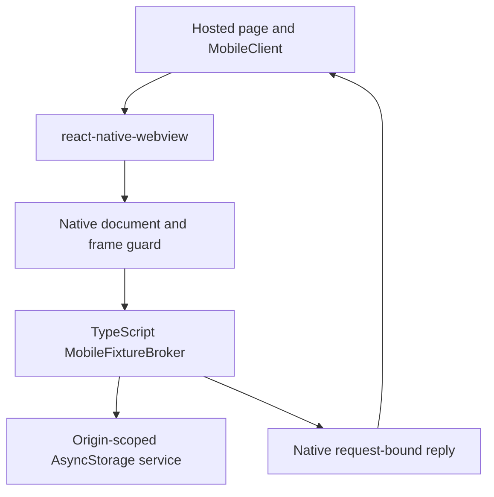

# Mobile WebView review and consolidation

## Goal

**Current decision:** the accepted `alohak_rnwv_pnpm_migration_v1` response on
`task-3vt.39.6.9` supersedes the intermediate keep-custom-WebView pilot decision.
Migrate both platforms to Expo-compatible RNWV using pnpm patches, preserving
the native document/reply contract. See [mobile-webview.md](mobile-webview.md)
for the current implementation/maintenance contract. The source assessment below
is historical; signed-device lifecycle/isolation acceptance remains outstanding.

Use `react-native-webview` (RNWV) for the companion's WebView implementation,
retaining only the native integration needed for document-bound RPC. Recommend
migration before adding GitHub authentication or more native browser features.

This is a source review and build plan, not a completed migration or device
acceptance. Reviewed application source at `8802edd`; its mobile adapters are
the storage implementation delivered in `3ee7dac`.

## Assumptions

Preserve the existing exact-origin/directory approval model, independent
fixture/storage grants, native main-frame checks, original-document identity,
and invalidation on navigation/background/process loss. Do not substitute a
page-reported URL or nonce for native context. Approved same-origin scripts
remain mutually trusted: main-frame checks do not isolate a hostile same-origin
script that can execute in the parent realm.

The current app uses Expo SDK 54 / React Native 0.81.5. Expo's installed
`bundledNativeModules.json` recommends RNWV **13.15.0**. npm's latest during
this review is **14.0.1**. Use 13.15.0 as the compatibility starting point;
evaluate later fixes explicitly rather than combining a major dependency
upgrade with the transport migration.

## Findings

### Most custom code is ordinary WebView plumbing

`mobile/modules/companion-webview/ios/CompanionWebViewModule.swift` and its
Android Kotlin counterpart instantiate/layout platform views, configure the
user agent and browsing settings, implement navigation/error callbacks, and
evaluate scripts. RNWV already provides these behaviors, plus established
keyboard/inset handling, loading/error UI hooks, navigation commands and
platform integrations. Maintaining another general-purpose WebView is not
justified by the companion's requirements.

### Stock messaging does not expose the complete required context

RNWV 13.15.0 Android `RNCWebView.createRNCWebViewBridge` already uses
`WebViewCompat.addWebMessageListener` when supported. The earlier explanation
that origin-aware Android messaging uniquely required our wrapper was too
broad. The library passes native `sourceOrigin` into its message event, but
discards `isMainFrame`, registers `Set.of("*")`, and falls back to
`addJavascriptInterface` on unsupported devices. The latter reports the
WebView's URL rather than equivalent frame-origin evidence. The reviewed
14.0.1 Android source retains these behaviors.

On Apple platforms, 13.15.0 `RNCWebViewImpl` forwards
`message.frameInfo.request.URL` but not `frameInfo.isMainFrame` or security
origin in its public message event. Main-frame-only script injection is not
the same as native rejection of subframe messages.

Consequently, replacing our broker context with ordinary `onMessage` fields
would change the current contract. The gap is specific metadata/enforcement,
not the underlying WebView implementation.

### Navigation callbacks are not document identity

RNWV Android `doUpdateVisitedHistory` emits a loading-start event; Apple also
has a History API shim. An SPA URL update must not allocate a new authorized
document or replace its original URL. Android's documented before-content
injection is not guaranteed reliable, and `onShouldStartLoadWithRequest` is
not called for its initial load. The Android native navigation decision also
has a timeout path that defaults to allowing the load.

Keep native capture/invalidation at real navigation/response lifecycle points.
Validate the initial source before loading. JS navigation callbacks are useful
for UI and defense in depth, not the sole authorization gate.

### URL whitelisting has a migration trap

RNWV `WebViewShared.createOnShouldStartLoadWithRequest` calls `Linking.openURL`
for URLs outside `originWhitelist`, before the application's request callback.
The whitelist matches origins, not directory grants, and should not be treated
as an exact-origin authorization implementation. Simply setting it to the
deployment origin would introduce automatic external opening that our shell
currently blocks. Preserve explicit native navigation rejection and popup
handling; verify external URLs never reach this automatic handoff branch.

### Current reply delivery needs redesign during migration

`mobile/App.tsx:81-84` sends every asynchronous reply through one React
`reply` state value. React can batch several updates into one render; a prop
is a latest-value slot, not a reliable message stream. This is a delivery risk
for concurrent requests, not a device-reproduced failure in this review.

The current native `runBound` methods check the document ID before calling
asynchronous JavaScript evaluation. RNWV's stock `injectJavaScript` likewise
has no expected-document parameter. Native check-to-execution races require
runtime probes; a page-side receiver alone is not sufficient evidence that
response bytes cannot reach a replacement document. Prefer request/frame-bound
native replies over injecting response-bearing script into the current page.
Android's existing `JavaScriptReplyProxy.postMessage` targets the injected
object in the sending frame; investigate WKScriptMessageHandlerWithReply for
the corresponding Apple path. Prove navigation/revocation behavior on devices.

### Our current lifecycle implementation is not a proven reference

The Android adapter (`onPageStarted`/`onPageFinished`, lines 66-75) requires
finish URL equality with its captured start URL. Legitimate early History API
changes can therefore leave readiness unresolved if the callback reports the
new URL. Its finish callback has no separate navigation token. On iOS,
`didFail`/`didFailProvisionalNavigation` (lines 106-107) do not correlate the
failure with `currentNavigation`, although finish does. A delayed cancellation
from an older navigation can reset current readiness. These are source-level
ordering concerns to cover in migration tests, not demonstrated exploits.

The TypeScript tests supply native document facts as fixtures. They test policy
given those facts, not whether WKWebView/Android callbacks produce them in the
required order. Native CI compiles the adapters; it does not run these probes.

### A small extension is possible, but not a drop-in subclass recipe

RNWV exposes `nativeConfig` and custom-view documentation. However, its iOS
customization document explicitly warns that it was imported and not adapted.
The 13.15.0 Fabric component instantiates `RNCWebViewImpl` directly and copies
specific event fields into generated C++ event types. Android's Fabric manager
also uses a concrete implementation and generated delegate. Extra fields on
an old-architecture subclass are not automatically a working Fabric API.

Prefer a version-pinned pnpm patch for the narrow missing native contract,
including codegen bindings where needed, over copying RNWV into another
standalone Expo view. Prove both Fabric builds before choosing the final patch
surface. No Objective-C runtime swizzling or delegate replacement that bypasses
RNWV's lifecycle handling is needed as a design assumption.

## Requirements and design

RNWV owns rendering, layout, browser settings and standard callbacks. A thin
TypeScript companion component maps its UI events to app state. Shared protocol,
grant and KV policy stay in TypeScript. Native integration is limited to:

1. Exact deployment scope validation and authoritative document lifecycle.
2. Main-frame/source-origin checks and bounded message dispatch, with no weaker
   bridge fallback for privileged RPC.
3. A typed response command or request-bound native reply path, correlated to
   its sending document and invalidated on navigation, disposal and process loss.

Keep browser settings explicit: mixed content never, third-party/shared cookies
off, file access off, no automatic popup/external handoff, and the companion UA
suffix. Reuse RNWV commands/callbacks rather than implementing their equivalents.
Only native facts can activate the broker. Give each mounted view an identity
so delayed events from a replaced view cannot reactivate or reset the new one.

## Build plan

1. Pin Expo-compatible RNWV and prove autolinking plus both Fabric native builds.
   Prototype the native metadata/reply integration before switching the app's
   active transport. Do not add a second user-selectable production backend.
2. Implement the minimal patch with explicit native scope/document/frame facts
   and a non-coalescing response path. Include patch application in frozen
   installs, native fingerprinting and CI path triggers. Carry native guards
   through reload, redirects, navigation errors, renderer death and unmount.
3. Replace the Expo view with a TypeScript wrapper around RNWV. Use its loading,
   error, UA, navigation and process callbacks/commands. Keep the existing
   page-facing RPC API through a transport adapter; preserve independent grants
   and existing persisted data. Remove the standalone Swift/Kotlin view module
   and its module registration/build/fingerprint references once parity holds.
4. Verify multiple simultaneous requests each resolve once; preserve KV
   hydration/flush/restart behavior and explicit errors. Run native compilation
   on both platforms and native runtime probes for direct iframe calls,
   srcdoc/popups, early/later History changes, denied redirects, rapid reload,
   stale cancellation/finish events, pending replies during navigation,
   background/foreground and process loss. Include ordinary keyboard/form use.
   Never infer these results from mocked context tests alone.
5. Build a fresh pilot binary (native dependency/runtime change), then perform
   the device acceptance already tracked in `task-3vt.39.6.3` before adding
   GitHub/S3 authority. Keep the patch small and suitable for upstream discussion.

## Concerns and expansions

The recommendation is to migrate, not to claim that a patched implementation
has already been validated. Patch size and runtime callback ordering remain
implementation unknowns. Full auth, native file/download product flows and
upstream contribution are separate work; RNWV support for them does not
automatically enable them in this app. A stock-JS-only design would require an
explicitly different trust contract and is not assumed by this review.

## Source references

- RNWV 13.15.0: [Android bridge](https://github.com/react-native-webview/react-native-webview/blob/v13.15.0/android/src/main/java/com/reactnativecommunity/webview/RNCWebView.java), [Android client](https://github.com/react-native-webview/react-native-webview/blob/v13.15.0/android/src/main/java/com/reactnativecommunity/webview/RNCWebViewClient.java).
- RNWV 13.15.0: [Apple implementation](https://github.com/react-native-webview/react-native-webview/blob/v13.15.0/apple/RNCWebViewImpl.m), [Fabric Apple component](https://github.com/react-native-webview/react-native-webview/blob/v13.15.0/apple/RNCWebView.mm), [codegen contract](https://github.com/react-native-webview/react-native-webview/blob/v13.15.0/src/RNCWebViewNativeComponent.ts).
- RNWV 13.15.0: [shared JS URL handling](https://github.com/react-native-webview/react-native-webview/blob/v13.15.0/src/WebViewShared.tsx), [Android customization](https://github.com/react-native-webview/react-native-webview/blob/v13.15.0/docs/Custom-Android.md), [Apple customization caveat](https://github.com/react-native-webview/react-native-webview/blob/v13.15.0/docs/Custom-iOS.md).
- [RNWV 14.0.1 Android bridge](https://github.com/react-native-webview/react-native-webview/blob/v14.0.1/android/src/main/java/com/reactnativecommunity/webview/RNCWebView.java).
- [Android JavaScriptReplyProxy](https://developer.android.com/reference/androidx/webkit/JavaScriptReplyProxy).
